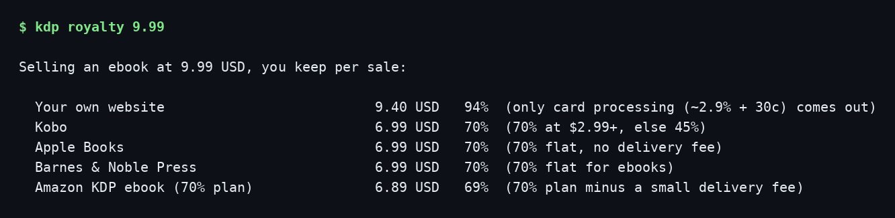
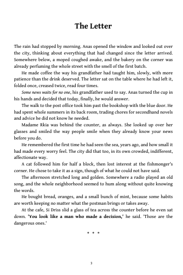
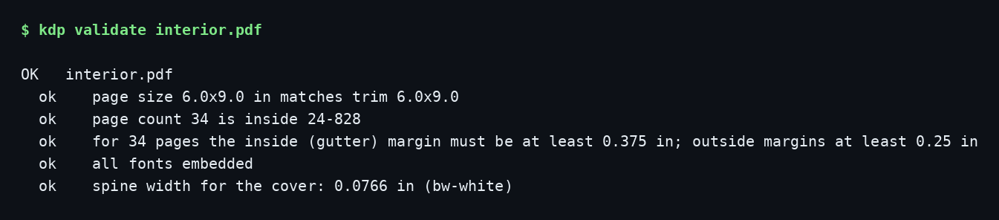
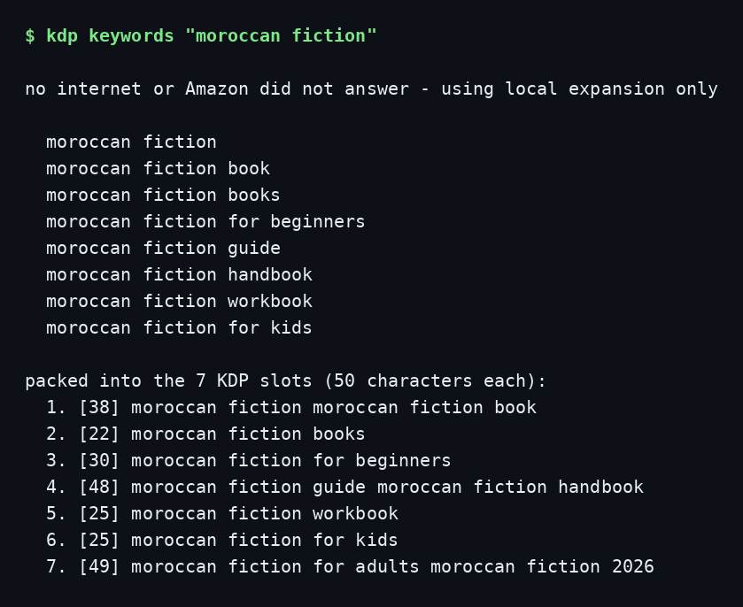

# KDP Toolkit

**Everything you need to put a book on Amazon KDP - one free command.**

Write your book in a plain text file, and this toolkit builds the two PDFs KDP asks for (interior + full cover wrap with the exact spine width), checks them against KDP's real rules before you upload, helps with keywords and metadata, and shows you what you actually keep per sale.

No account connection, no API keys, no paid services. It runs on your computer and your files never leave it.



Made by the team behind [BookFolio](https://bookfolio-demo.pages.dev), the WordPress theme that turns an author website into a real bookstore. This toolkit gets your book onto Amazon; BookFolio is how you sell it from your own site and keep ~94%.

---

## Install (2 minutes)

1. Install Python from [python.org/downloads](https://www.python.org/downloads/) (on Windows, tick **"Add python.exe to PATH"** during install).
2. Open Terminal (Mac) or Command Prompt (Windows) and paste:

```bash
pip install git+https://github.com/devanasolver/kdp-toolkit
```

(On a Mac, use `pip3` if `pip` is not found.)

## Your first book in 4 commands

```bash
kdp new mybook --title "My Book" --author "Your Name"
```

This makes a folder with `manuscript.md` (write your book in it), `metadata.json` (title, description, keywords), and a README.

Write your book in `manuscript.md`. Chapters start with `# Chapter title`. Blank line = new paragraph. `*italic*`, `**bold**`, and `***` for a scene break. That's the whole format.

```bash
kdp interior mybook/manuscript.md --title "My Book" --author "Your Name" -o mybook/interior.pdf
```

A print-ready interior PDF: real book margins (the gutter grows with your page count, as KDP requires), chapters starting on right-hand pages, page numbers, and an embedded book font.



```bash
kdp cover --title "My Book" --author "Your Name" --pages 120 --back-text "A short pitch for the back cover." -o mybook/cover.pdf
```

The full cover wrap - front, spine, back - at the exact size KDP wants, spine width calculated from your page count and paper type. Add `--front-image myart.png` for a real cover image. Add `--guides` to get a checking copy with trim, spine, and barcode lines drawn on it (never upload the guides version).

```bash
kdp validate mybook/interior.pdf
kdp validate mybook/cover.pdf --cover --pages 120
```



Then upload both PDFs at [kdp.amazon.com](https://kdp.amazon.com) and paste your metadata in. The upload walkthrough with the traps to avoid is in [docs/upload-guide.md](docs/upload-guide.md).

## What each command does

| Command | What it does |
|---|---|
| `kdp new` | Start a book project folder |
| `kdp interior` | Manuscript text file → print-ready interior PDF |
| `kdp cover` | Exact-size cover wrap PDF (spine math included) |
| `kdp validate` | Catches the things KDP rejects files for: wrong page size, wrong page count, fonts not embedded, wrong cover size |
| `kdp keywords "topic"` | Keyword ideas from Amazon's own search suggestions, packed into the 7 KDP slots (50 characters each) |
| `kdp metadata` | Checks title, description and keywords against KDP's rules |
| `kdp royalty 9.99` | What you keep per sale on KDP vs Kobo, Apple, B&N, and your own site |
| `kdp royalty 14.99 --print --pages 300` | Paperback math: printing cost, 50%/60% tiers, lowest price KDP allows |
| `kdp ads` | Amazon Ads quick-start plan + a ready-to-upload keyword CSV |
| `kdp report royalties.xlsx` | Summarizes the royalty report you download from KDP |
| `kdp specs` | Prints the verified KDP spec tables |



## The numbers are checked against KDP's own pages

KDP changes its rules and most blog posts are stale. Every number in this toolkit was verified against the live KDP help pages in October 2026 (sources in `src/kdp_toolkit/specs.py`):

- **Margins**: outside at least 0.25" (no bleed) or 0.375" (bleed); gutter 0.375" up to 150 pages, growing to 0.875" at 701-828 pages
- **Bleed**: 0.125" on the top, bottom, and outside edge
- **Spine width**: pages x 0.002252" (white), 0.0025" (cream), 0.002347" (premium color); spine text only above 79 pages
- **Printing cost**: fixed + per-page tables for every Amazon marketplace, black/groundwood/standard-color/premium-color, regular and large trim
- **Paperback royalty**: 60% tier only above the threshold price ($9.99 in the US) - below it you get 50%, a 2025 change most calculators still miss
- **eBook royalty**: the 70% band is $2.99-$12.99 since July 2026 (it was $9.99), minus a $0.15/MB delivery fee

The test suite re-checks the math against KDP's own worked examples:

```bash
pip install "kdp-toolkit[dev] @ git+https://github.com/devanasolver/kdp-toolkit"
python -m pytest tests/
```

## What it does not do

- **It does not upload for you.** KDP's upload form changes often and browser automation breaks silently. You upload two PDFs and paste the metadata - [the guide](docs/upload-guide.md) walks you through it in about 10 minutes.
- **Paperback and ebook only.** Hardcover is not covered yet.
- **The validator checks the file, not your layout.** It proves the page size, page count, fonts, and cover dimensions are right. Whether your text sits nicely inside the margins is yours to eyeball in KDP's online previewer (it checks that too, after upload).
- **Selling from your own site** is the highest-royalty row in `kdp royalty` for a reason. If you want that row, that is what [BookFolio](https://bookfolio-demo.pages.dev) builds.

The bundled font is [Gentium Book Plus](https://software.sil.org/gentium/), SIL Open Font License (`src/kdp_toolkit/fonts/OFL.txt`).

## License

MIT - see [LICENSE](LICENSE).
