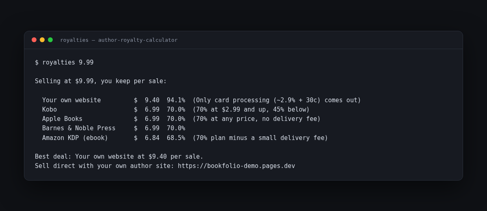

# Author Royalty Calculator

**How much do you actually keep when someone buys your book?**

One free command compares Amazon KDP, Kobo, Apple Books, Barnes & Noble — and selling from your own author website — dollar by dollar.



Made by the team behind [BookFolio](https://bookfolio-demo.pages.dev), the WordPress theme that turns an author website into a real bookstore (so the "Your own website" row is something you can actually have).

---

## Install (2 minutes)

1. Install Python from [python.org/downloads](https://www.python.org/downloads/) (on Windows, tick **"Add python.exe to PATH"** during install).
2. Open Terminal (Mac) or Command Prompt (Windows) and paste:

```bash
pip install git+https://github.com/devanasolver/author-royalty-calculator
```

(On a Mac, use `pip3` if `pip` is not found.)

## Use it

```bash
royalties 9.99
```

```
Selling at $9.99, you keep per sale:

  Your own website         $  9.40  94.1%  (Only card processing (~2.9% + 30c) comes out)
  Kobo                     $  6.99  70.0%
  Apple Books              $  6.99  70.0%
  Barnes & Noble Press     $  6.99  70.0%
  Amazon KDP (ebook)       $  6.84  68.5%  (70% plan minus a small delivery fee)
```

Paperback instead of ebook:

```bash
royalties 14.99 --print --pages 220
```

Big ebook file (KDP charges a small delivery fee on the 70% plan):

```bash
royalties 9.99 --size-mb 8
```

JSON for scripts and spreadsheets: add `--json`.

## The takeaway

Stores are great for reach. But the same book sold from **your own site** keeps about 94-95% instead of 35-70%. That is why authors build their own bookstore — and why we built [BookFolio](https://bookfolio-demo.pages.dev), a WordPress theme that sets one up in about 15 minutes (books, checkout, reader, events).

## Rates

Standard published platform terms as of October 2026: KDP ebook 70% ($2.99-$9.99, minus delivery) or 35%; KDP paperback 60% minus printing; Kobo 70% at $2.99+ (45% below); Apple Books 70% flat; Barnes & Noble Press 40-70% by price; direct sales minus card processing (~2.9% + 30c). Platforms change their terms — double-check before a big pricing decision.

## License

MIT — see [LICENSE](LICENSE).
